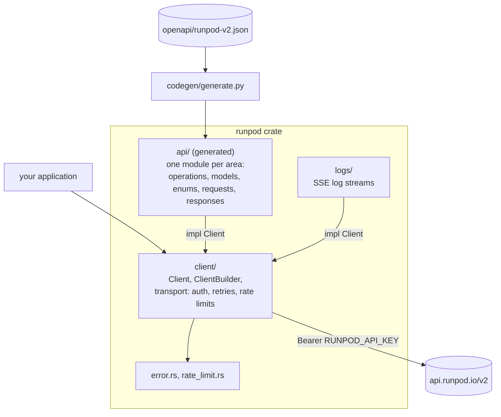

# rs-runpod-sdk: feature docs

> **Last verified against code:** 2026-11-20 @ the initial commit

`runpod` (crate name, `Cargo.toml:2`) is an unofficial async Rust client for
the Runpod REST API v2 at `https://api.runpod.io` (`src/client/mod.rs:22`).
It is a library: it deploys nothing. Its types and 119 of its methods are
generated from a checked-in copy of Runpod's OpenAPI document
(`openapi/runpod-v2.json`); the other two operations, the Server-Sent Events
log streams, are hand-written. Every one of the document's 121 operations
is covered; `codegen/operations.txt` lists the generated ones. The overview
page's `GET /v2/openapi.json`, which is not among the document's own paths,
is `Client::openapi_document()` (`src/openapi.rs`).

## Index

| Component | Status | Doc |
|---|---|---|
| Client: auth, transport, retries, rate limits, errors | STABLE | [client.md](./client.md) |
| API areas: the generated operations and types | PARTIAL (verified against the spec, not yet against live Runpod) | [api.md](./api.md) |
| Log streams (SSE) | PARTIAL (no automatic reconnect) | [logs.md](./logs.md) |
| Code generator | STABLE | [codegen.md](./codegen.md) |
| Testing, changelog & releases | STABLE | [testing-and-releases.md](./testing-and-releases.md) |

## Known defects

| Component | Defect | Severity |
|---|---|---|
| API areas | Nothing here has been run against live Runpod yet. The operations are checked against the OpenAPI document (every example round-trips, `tests/spec_examples.rs`) and a mock server (`tests/operations.rs`), so where the live API differs from its own document, this crate follows the document. | Medium |
| API areas | Fields the spec marks required are non-`Option` (`codegen/runpod_codegen/schemas.py:210`). A live answer that omits one fails the whole call with `Error::Decode`, not just that field. | Medium |
| Client / Error | A `POST` that creates is correctly not retried after a timeout (`src/client/transport.rs:65`), but `Error::is_transient()` still answers `true` for it (`src/error.rs:97`). A caller that retries on that can create twice; the doc on `Error::Transport` says so, the type does not enforce it. | Low |
| Logs | `LogStream` ends when the connection drops; it does not reconnect with `Last-Event-ID` by itself (`src/logs/mod.rs:144`). The caller resumes from the last `LogEvent::id`. | Low |
| API areas | `GET /v2/catalog/templates`: Runpod's example answer has a `pagination` block its schema (`TemplateList`) does not declare. The type follows the schema, so a real `pagination` block is dropped. Recorded in `tests/support/spec.rs:12`. | Low |
| API areas | Integers are `i64` and timestamps `String` throughout (`codegen/runpod_codegen/schemas.py:90`): no unsigned types, no parsed dates. | Low |
| Signup | `create_authentication_attempt` needs a `codeChallenge` (unpadded base64url SHA-256 of a verifier); the crate does not compute one, to avoid a crypto dependency. | Low |
| Scope | The Serverless *job* API (`https://api.runpod.ai/v2/<endpoint>/run`, `runsync`, `status`, `stream`, `cancel`, `health`) is a separate API, not in this document, and not covered. | Low |
