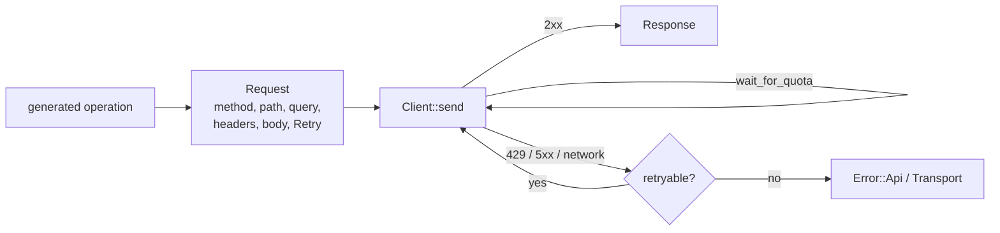

# Client: auth, transport, retries, rate limits, errors

> **Status:** STABLE
> **Owners (code):** `src/client/`, `src/error.rs`, `src/rate_limit.rs`
> **Related docs:** [api.md](./api.md), [logs.md](./logs.md)
> **Last verified against code:** 2026-11-20 @ the initial commit

## Overview

Every operation is a method on `Client`, and every method ends in one
function: `Client::send` (`src/client/transport.rs:48`). It adds auth, waits
out a spent rate-limit window, sends, retries what may be retried, and turns
an error answer into `Error::Api`. The generated operations describe a call
as a `Request` (`src/client/request.rs`) and read the answer through
`Response::json` / `text`.

## How it works today

### Interfaces

| Kind | Name | Notes |
|---|---|---|
| constructor | `Client::new(key)` (`src/client/mod.rs:59`) | Refuses an empty key with `Error::MissingApiKey`. |
| constructor | `Client::anonymous()` (`src/client/mod.rs:70`) | No key, for the signup operations only; anything else answers `MissingApiKey` before sending. |
| builder | `Client::builder()` | `api_key`, `base_url`, `team_id` (`X-Team-Id`, `src/client/builder.rs:69`), `timeout` (60 s, `src/client/builder.rs:7`), `max_attempts` (4, `:8`), `respect_rate_limit` (on). |
| state | `Client::rate_limit()` (`src/client/mod.rs:80`) | The last `RateLimit`/`RateLimit-Policy` headers, parsed (`src/rate_limit.rs:78`). Clones share it, as quotas are per user. |

`Client` and `ClientBuilder` never print the API key under `{:?}`.

### Retries

`Retry` (`src/client/request.rs:11`) is decided by the generator per
operation (`codegen/runpod_codegen/operations.py:192`):

- `Idempotent`: `GET`, `PUT`, `PATCH`, `DELETE`, and the one `POST` with an
  `Idempotency-Key` (signup). Retried on network errors, 429 and 5xx.
- `RateLimitOnly`: every other `POST` (creates, pod actions, exec). Retried on
  429, which Runpod sends before acting, and on a connection that was refused
  (so never sent, `src/client/transport.rs:65`). A 5xx or a timeout is
  returned: the pod may exist.

Waits: `Retry-After` plus up to 500 ms jitter; without it, 0.5 s doubling per
attempt plus up to half again (`src/client/transport.rs:192`). A `Retry-After`
over two minutes (`src/client/transport.rs:16`) is not slept through: the 429
is returned. Jitter comes from the std hasher's random keys, so there is no
`rand` dependency (`src/client/transport.rs:199`).

### Rate limits

Every answer's `RateLimit` header is kept (`src/client/transport.rs:158`).
Before each attempt, if a window had `r=0` and its `t` has not elapsed,
the client sleeps until it has (`src/client/transport.rs:145`,
`src/rate_limit.rs:45`). Turn this off with `respect_rate_limit(false)`.

### Timeouts

Connect timeout 15 s; request timeout 60 s (whole request, body included).
`exec_pod` raises its own to `timeoutSeconds + 30 s` so a long command is not
cut off by the client (`codegen/runpod_codegen/operations.py:256`,
`src/client/transport.rs:135`). Log streams have no request timeout.

### Errors

`Error` (`src/error.rs`): `Transport` (no answer), `Api` (an error status;
`ApiError` carries the problem+json `title`, `detail`, `errors` and
`Retry-After`), `UnexpectedStatus`, `Decode`, `Encode`, `MissingApiKey`.
Helpers: `status()`, `is_not_found()`, `is_conflict()`, `is_rate_limited()`,
`is_transient()`.

### Edge cases & gotchas

- `is_transient()` is true for any `Transport` error, including a create that
  timed out after Runpod received it. List before retrying a create.
- Path ids are percent-encoded (`src/client/request.rs:66`), so an id with a
  `/` cannot reach another endpoint.

## History & references

- Rate-limit behaviour follows `https://docs.runpod.io/api-reference-v2/rate-limits`.
- The design follows `rs-vastai-sdk`'s client, and fixes two of its known
  defects: request types holding credentials redact them under `{:?}`, and
  the HTTP layer has tests (`tests/transport.rs`).

## Proposed / Ideas (backlog)

| Idea | Motivation | Sketch | Status |
|---|---|---|---|
| A `may_have_been_applied()` on `Error` | Make the create-retry hazard a type-level answer | Carry the `Retry` class into `Error::Transport` | Idea |
