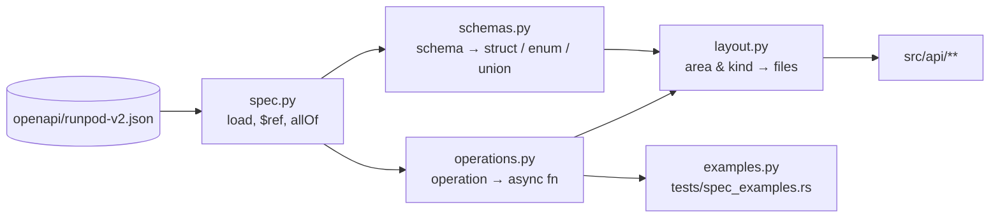

# Code generator

> **Status:** STABLE
> **Owners (code):** `codegen/generate.py`, `codegen/runpod_codegen/`
> **Related docs:** [api.md](./api.md), [testing-and-releases.md](./testing-and-releases.md)
> **Last verified against code:** 2026-11-20 @ the initial commit

## Overview

`python3 codegen/generate.py` turns `openapi/runpod-v2.json` into `src/api/`
and `tests/spec_examples.rs`. Standard-library Python plus `rustfmt`. Its
output is committed; `--check` (run by CI) fails when the committed files
are not what the document produces.



## How it works today

| Module | Does |
|---|---|
| `spec.py` | Loads the document; resolves `$ref`; flattens `allOf` into one property set; resolves shared parameters and responses. |
| `naming.py` | camelCase → snake_case, raw identifiers for keywords (`r#type`), enum variant names (`QUEUE_DELAY` → `QueueDelay`, `1h` → `Every1h`), and descriptions → rustdoc that cannot become doctests. |
| `schemas.py` | Object → struct (`Default` derived when every field allows it); string enum → enum with `Other(String)` and hand-written serde (`:133`); `oneOf` with a discriminator → internally tagged enum, otherwise untagged (`:165`); `anyOf [T, null]` → `Option<T>`; inline schemas become named types (`Parent` + `Field`, `:39`). |
| `operations.py` | One `async fn` per operation (the two SSE ones are skipped), its `Params` struct, the multi-status answer enum, `_all` for paginated lists, and the `Retry` class. Records each operation's body and answer types for the example test. |
| `layout.py` | Puts each type in a module (`:104`): the one area using it; else the area its name belongs to (`HOME_PREFIXES`, `:40`); else `common`. Then by kind (`:131`). Splits an area's operations per sub-resource over 450 lines (`:76`). Every file imports `crate::api::*`, so placement never affects whether it compiles. |
| `examples.py` | Writes `tests/spec_examples.rs`. |

### Updating to a new API version

```sh
curl -fsSL https://api.runpod.io/v2/openapi.json -o openapi/runpod-v2.json
python3 codegen/generate.py
cargo test --all-targets
```

Then read the diff of `src/api/` and `codegen/operations.txt`, and add what
changed to `CHANGELOG.md` under `[Unreleased]`. A renamed or removed type is
a breaking change.

### Edge cases & gotchas

- Inline schema names are derived, so the first time a name collides the
  second gets a `2` suffix; a reordering in the document can swap them.
- `if/then` conditions in `allOf` (e.g. "image required unless templateId")
  are ignored: both fields are optional, Runpod enforces the rule.
