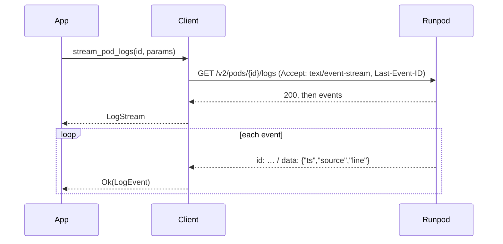

# Log streams (SSE)

> **Status:** PARTIAL (no automatic reconnect)
> **Owners (code):** `src/logs/mod.rs`, `src/logs/parser.rs`
> **Related docs:** [client.md](./client.md)
> **Last verified against code:** 2026-11-20 @ the initial commit

## Overview

Runpod streams pod and Serverless worker logs as Server-Sent Events. These
two operations are not generated: `stream_pod_logs` (`src/logs/mod.rs:75`) and
`stream_worker_logs` (`src/logs/mod.rs:87`) return a `LogStream`, a
`Stream<Item = Result<LogEvent, Error>>`.

## How it works today

- Connecting goes through the same `Client::send` as everything else, so a
  404 or 429 is an error from the call, not from the stream.
- `LogStreamParams`: `source` (container or system), `tail` (0–5000, Runpod's
  default 100), `since` (RFC 3339), `last_event_id` (resume point).
- The parser (`src/logs/parser.rs`) handles events split across chunks, CRLF,
  UTF-8 split mid-character, comments and keep-alives. A `data:` payload that
  is not a log event yields one `Err(Error::Decode)` and the stream goes on.
- A network error yields one `Err(Error::Transport)` and ends the stream.

### Edge cases & gotchas

- The stream follows the log until Runpod closes it. Drop it to stop.
- No reconnect: resume by calling again with `last_event_id` set to the last
  event's `id`.
- No request timeout applies; wrap the stream in `tokio::time::timeout` if
  you want one.
