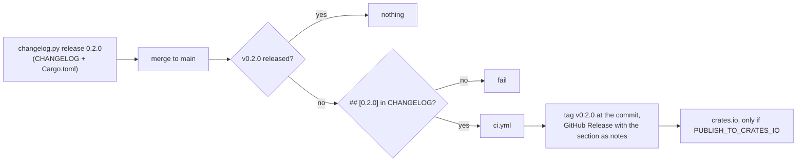

# Testing, changelog & releases

> **Status:** STABLE
> **Owners (code):** `tests/`, `.github/workflows/`, `scripts/changelog.py`, `CHANGELOG.md`
> **Related docs:** [codegen.md](./codegen.md)
> **Last verified against code:** 2026-11-20 @ the initial commit

## Overview

No test talks to Runpod. They check the crate against Runpod's own document
and against a local mock server (`wiremock`).

## How it works today

### Tests

| File | Checks |
|---|---|
| `src/**` unit tests | Rate-limit header parsing, SSE parsing across chunks, path encoding, backoff and jitter bounds, key redaction. |
| `tests/transport.rs` | Bearer auth, `X-Team-Id`, a GET retried after 503, a create *not* retried after 503 but retried after 429 with `Retry-After`, problem+json → `ApiError`, the attempt cap, rate-limit headers kept and a spent window waited out, signup and the OpenAPI document without a key. |
| `tests/operations.rs` | Query encoding (JSON `filters`, comma arrays, enums), escaped path ids, `_all` across two pages, `create_pod`'s 201 vs 202, 204 answers, Markdown answers, unknown enum values, credential redaction, omitted unset fields. |
| `tests/logs.rs` | Pod and worker log streams end to end, with `Last-Event-ID`; an error status fails the call. |
| `tests/spec_examples.rs` (generated) | Every request and response example in the document (132) decodes into its type and re-encodes to the same JSON, so a missing or misnamed field fails. Exceptions, with reasons: `tests/support/spec.rs:12`. |

### CI: `.github/workflows/ci.yml`

On pushes to `main` (not documentation-only ones), on pull requests, and
from the release workflow: `cargo fmt --check`, `clippy --all-targets -D
warnings`, `cargo test --all-targets`, doctests, `cargo doc` with
`-D warnings`, `codegen/generate.py --check`, and
`scripts/changelog.py check`. Rust 1.100.0, mold and sccache, as the org's
other Rust repositories.

### Changelog

`CHANGELOG.md` follows Keep a Changelog 1.1.0. `scripts/changelog.py check`
enforces it: `[Unreleased]` first, released versions newest first with ISO
dates, only the six change types, no duplicates, `Cargo.toml` not behind the
newest entry. Add what you change under `[Unreleased]` in the same commit.

### Releases: `.github/workflows/release.yml`

- Runs on pushes to `main` that touch `Cargo.toml` or `CHANGELOG.md`, and by
  hand to retry.
- A version with a `-` is a prerelease.
- crates.io is off unless the repository variable `PUBLISH_TO_CRATES_IO` is
  `true` and `CARGO_REGISTRY_TOKEN` is set. The name `runpod` on crates.io
  belongs to an unrelated project (checked 2026-11-20), so publishing there
  needs a rename; the step refuses a crate whose repository is not this one.

### Edge cases & gotchas

- Merging a changelog edit under `[Unreleased]` does nothing: the version in
  `Cargo.toml` is already released.
- Bumping `Cargo.toml` without a matching section fails the release job,
  rather than publishing empty notes.
- The tag is created by the workflow's token, which does not trigger other
  workflows.
